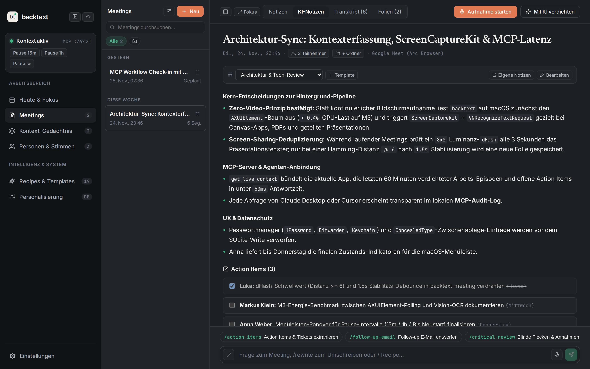
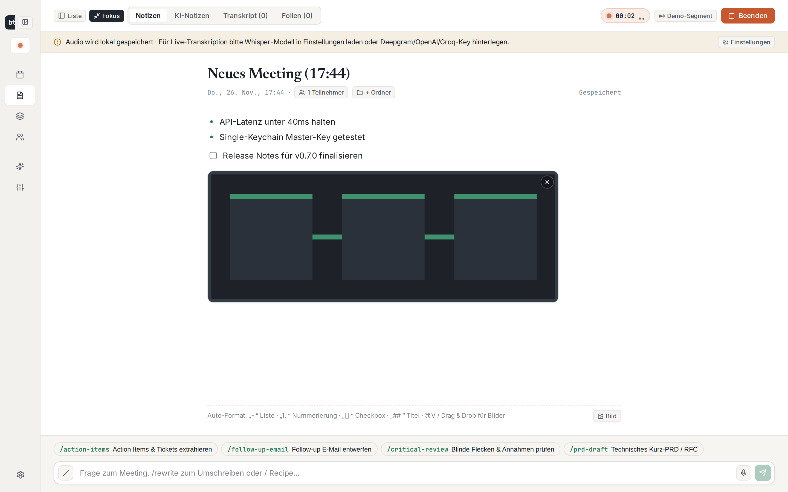
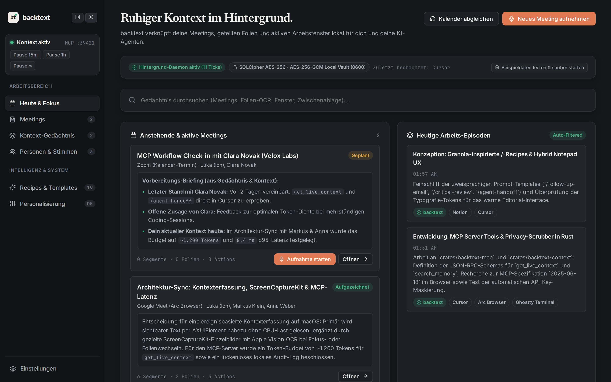
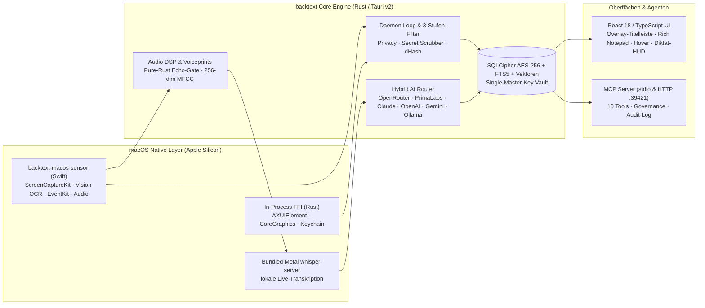

<div align="center">

# backtext

**Bot-freies Meeting-Gedächtnis, stiller Desktop-Kontext & lokaler MCP-Server für macOS (Apple Silicon).**

[](https://github.com/LukaAsceric/backtext/releases/latest)
[-18181B?style=flat-square&logo=apple&logoColor=white)](https://github.com/LukaAsceric/backtext/releases)
[](https://v2.tauri.app)
[](#sicherheit--datenschutz)
[](#mcp-server-f%C3%BCr-claude-cursor--ki-agenten)
[](LICENSE)

</div>

---

**`backtext`** (*background* + *context*) ist eine Local-First **macOS-Desktop-App** auf Basis von **Tauri v2, Rust, nativem Swift und React/TypeScript**. Sie verbindet das ruhige, bot-freie Meeting-Erlebnis von **Granola** mit dem kontinuierlichen Hintergrund-Arbeitsgedächtnis von **Littlebird** — AES-256-verschlüsselt auf deinem Mac und direkt ansprechbar für deine KI-Agenten via **Model Context Protocol (MCP)**.

<p align="center">
  
</p>

<details>
<summary><strong>Weitere Screenshots ansehen (Rich Notepad mit Bildern &amp; Heute-Dashboard)</strong></summary>
<br />
<p align="center">
  
  <em>Granola-inspiriertes Rich Notepad ohne Editor-Ballast: automatische Listen &amp; Checkboxen, Bilder per ⌘V / Drag &amp; Drop und Live-Aufnahme im Fokus-Modus.</em>
</p>
<br />
<p align="center">
  
  <em>Heute-Dashboard: Automatische Vorbereitungs-Briefings für anstehende Termine, verdichtete Arbeits-Episoden und hybride Gedächtnissuche.</em>
</p>
</details>

---

## Highlights

| Bereich | Was `backtext` kann |
|---|---|
| **Bot-freie Meetings** | Nimmt Mikrofon + System-Audio direkt via `ScreenCaptureKit` & `AVAudioEngine` auf — **ohne Meeting-Bot**, ohne macOS-Audio-Ducking (100 % Gesprächslautstärke) und mit mehrstufigem Pure-Rust-Echo-Filter. Automatische Erkennung für Microsoft Teams (Desktop & Browser), Zoom, Google Meet & Webex. |
| **Warm Metal `whisper-server`** | Gebündelter statischer Apple-Silicon-Metal-`whisper-server` hält das lokale Whisper-Modell während des Meetings warm im Speicher (~85–90 % geringere GPU-/CPU-Last) + optional Cloud-STT (**Deepgram Nova-3**, **Groq**, **OpenAI Whisper**). |
| **Rich Notepad & KI-Notizen** | Ruhiges Notizblatt mit automatischer Formatierung (`- ` Listen, `1. ` Nummerierung, `[] ` Checkboxen, `## ` Titel), **Bild-Support via `⌘V` & Drag & Drop**, **automatischen Meeting-Titeln**, klickbaren **`[MM:SS]`-Transkript-Referenzen**, 3-stufiger Lesebreite (`Standard` / `Breit` / `Füllen`), Ordnern, Serien-Verknüpfung & frei editierbaren **Templates** + **`/`-Recipes**. |
| **Kontext-Gedächtnis** | Stiller Hintergrund-Sensor (`AXUIElement`, `ScreenCaptureKit`, Apple `Vision` OCR, sichere Zwischenablage) mit **3-Stufen-Filter**: Privacy-Blocklisten (`1Password`, Banking, Privatfenster, `AXSecureTextField`), lokaler Secret-/PII-Scrubber (API-Keys, JWTs, IBANs, Kreditkarten) & `dHash`-Deduplizierung. |
| **Systemweites Voice Typing** | Globaler Shortcut (`⌥⇧ D`) mit transparentem, **nicht-fokussierendem Diktat-HUD** über allen macOS-Apps, zuverlässigem In-Process-CoreGraphics-Paste (`Word`, `Safari`, `Slack`, …) sowie konfigurierbarem Feinschliff (`Aus`, lokal via **Ollama**, oder über den **KI-Router**). |
| **Multi-LLM Router** | Natives SSE-Streaming für **OpenRouter**, **PrimaLabs (Zero Data Retention)**, **Anthropic Claude**, **OpenAI**, **Google Gemini** und lokales **Ollama** (inkl. Live-Modell-Abruf & Verbindungstest). |
| **Hover-Assistent (`⌥ Space`)** | Schwebendes, vor Bildschirmfreigaben geschütztes Overlay (`NSWindowSharingNone`) für schnelle Fragen mit Live-Fensterkontext & `/`-*Recipes*. |
| **1-Klick In-App Auto-Updater** | Lädt neue GitHub-Releases direkt in der App, entfernt das Quarantine-Flag und signiert mit deinem lokalen Zertifikat **`backtext Local Signer`**, sodass macOS-Berechtigungen dauerhaft über alle Updates erhalten bleiben. |

---

## Architektur



---

## Installation auf macOS (Apple Silicon M1–M5)

1. Lade unter [**GitHub Releases**](https://github.com/LukaAsceric/backtext/releases/latest) die aktuelle **`backtext_0.7.0_macos_arm64.dmg`** herunter.
2. Ziehe **`backtext.app`** in deinen `/Applications`-Ordner (`backtext-mcp`, `backtext-macos-sensor`, `whisper-cli` und `whisper-server` sind bereits vollständig im Bundle integriert).
3. Entferne vor dem allerersten Start einmalig das macOS-Quarantäne-Attribut (oder starte die enthaltene `.command`-Hilfsdatei im DMG):
   ```bash
   xattr -cr /Applications/backtext.app && open /Applications/backtext.app
   ```
4. **Empfohlen für Updates ohne erneute Berechtigungen:** Klicke einmalig unter **Einstellungen → System & Updates** auf **„Lokales Signatur-Zertifikat einrichten“** (`backtext Local Signer`). Danach funktionieren alle künftigen Updates per **1 Klick direkt in der App** — ohne dass macOS *Bedienungshilfen*, *Bildschirmaufnahme* oder *Mikrofon* zurücksetzt.

---

## MCP-Server für Claude, Cursor & KI-Agenten

`backtext` startet automatisch einen lokalen **Streamable-HTTP MCP-Server** auf `http://127.0.0.1:39421/mcp` und liefert zusätzlich die eigenständige `stdio`-Binary `backtext-mcp` mit. Alle 10 Tools lassen sich unter **Einstellungen → MCP & Datenschutz** feingranular steuern und live im Inspector testen:

`get_live_context` · `search_memory` · `list_meetings` · `get_meeting_context` · `get_meeting_transcript` · `get_meeting_screenshots` · `get_person_dossier` · `get_project_context` · `get_user_profile` · `remember_agent_insight`

### Cursor / Windsurf (`.cursor/mcp.json`)
```json
{
  "mcpServers": {
    "backtext": {
      "url": "http://127.0.0.1:39421/mcp"
    }
  }
}
```

### Claude Code CLI
```bash
claude mcp add --transport http backtext http://127.0.0.1:39421/mcp
```

### Claude Desktop (`claude_desktop_config.json`)
Kopiere die fertige `stdio`-Konfiguration direkt mit einem Klick in **Einstellungen → MCP & Datenschutz**.

---

## Sicherheit & Datenschutz

- **Local-First & AES-256 at Rest:** Alle Meetings, Transkripte, Notizen, Voiceprints und Kontext-Episoden werden lokal in einer mit **SQLCipher (AES-256)** verschlüsselten SQLite-Datenbank gespeichert.
- **Maximal 1× Schlüsselbund-Abfrage:** `backtext` verwaltet nur einen einzigen Master-Key (`db_master_key`) im macOS-Schlüsselbund; alle API-Keys werden in einem `0600`-geschützten AES-256-GCM-Tresor abgelegt.
- **Lokaler Privacy-Shield vor jedem Write:** Passwortmanager (`1Password`, `Bitwarden`, `Keychain`), `AXSecureTextField`, Inkognito-/Privatfenster sowie erkannte API-Keys, JWTs, PEM-Blöcke, IBANs und Kreditkarten werden lokal herausgefiltert bzw. geschwärzt.

---

## Lokale Entwicklung

Voraussetzungen auf macOS (Apple Silicon): **Rust** (`rustup`), **Node.js 22+**, **pnpm**, **Xcode Command Line Tools** (`swiftc`).

```bash
git clone https://github.com/LukaAsceric/backtext.git
cd backtext
pnpm install

# Nativen macOS-Sensor kompilieren (für echte Audio-/OCR-/EventKit-Signale)
mkdir -p macos-sensor/build
swiftc -O -target arm64-apple-macos13.0 macos-sensor/Sources/main.swift \
  -framework AppKit -framework ApplicationServices -framework CoreGraphics \
  -framework CoreAudio -framework CoreMedia -framework AVFoundation \
  -framework Vision -framework EventKit -framework ScreenCaptureKit \
  -o macos-sensor/backtext-macos-sensor

# Desktop-App im Dev-Modus starten
pnpm tauri dev
```

### Tests ausführen
```bash
cargo test --workspace
pnpm run typecheck && pnpm run test && pnpm run build
```

---

## Lizenz

MIT © [Luka Asceric](https://github.com/LukaAsceric)
